**免费下载 flac 无损音乐，仅需要普通的安卓手机即可！**

*思路请定位第三个标题*

## 吐槽

早在十几、二十年前的音乐仅仅只是无损音乐或部分音乐需要 VIP，现在的音乐只要是个歌就要 VIP，真是魔了。更搞笑的是：下载后的文件是加密的，换平台或 VIP 过期就无法听了，花了钱却依然不是自己的东西。酷狗概念版看广告可以听歌，但是后期整个软件全**广告，都不如花 15 块钱买包月 VIP 换个清净。

⚠️ 以下方法仅作技术参考，请勿用于侵权以及商业用途。

## 实践

**步骤一**：下载 “**酷狗概念版**” 和 “**硬柿子音视频转换器**”。

| 酷狗概念版                                                | 硬柿子音视频转换器                                        |
| --------------------------------------------------------- | --------------------------------------------------------- |
| 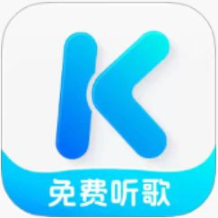 | 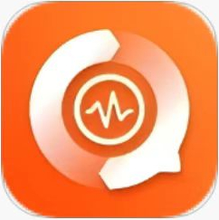 |

**第二步**：打开并获取 “**酷狗概念版**” 的 **SVIP**。

| 获取 普通 VIP                                             | 获取 SVIP                                                 |
| --------------------------------------------------------- | --------------------------------------------------------- |
|  | 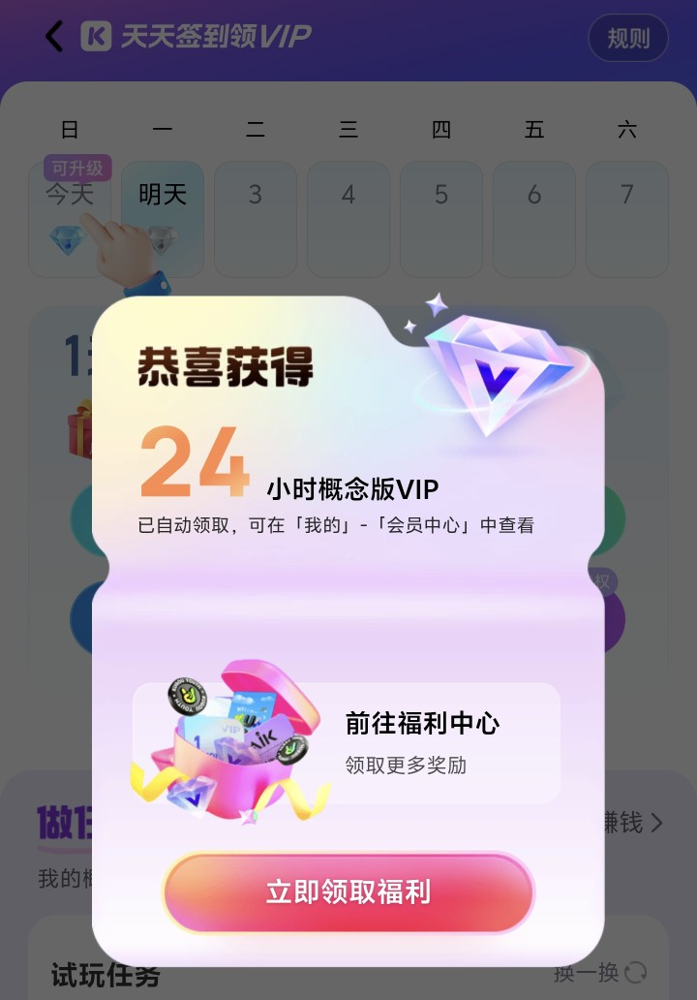 |

**第三步**：然后随便下载一个音乐，比如 凤凰传奇的《奢香夫人》。音质根据自己喜好选择。

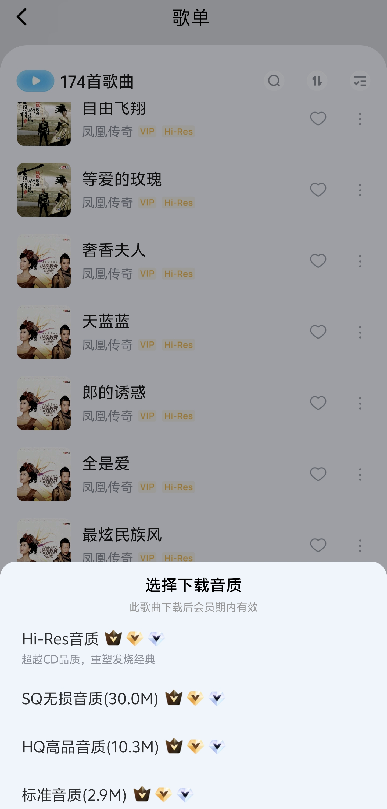

**第四步**：下载完成后的文件是加密的，打开 “**硬柿子音视频转换器**” 进行破解。点击 “音频转换”。

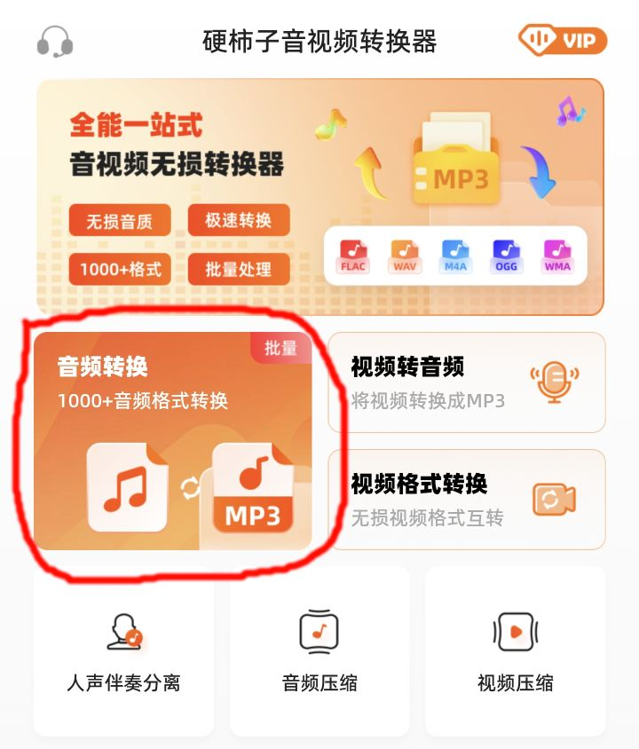

找到刚下好的加密文件（通常为带 kgg、kgm 等标识），选中然后点击下一步。（一次只能选一个，多选付费）

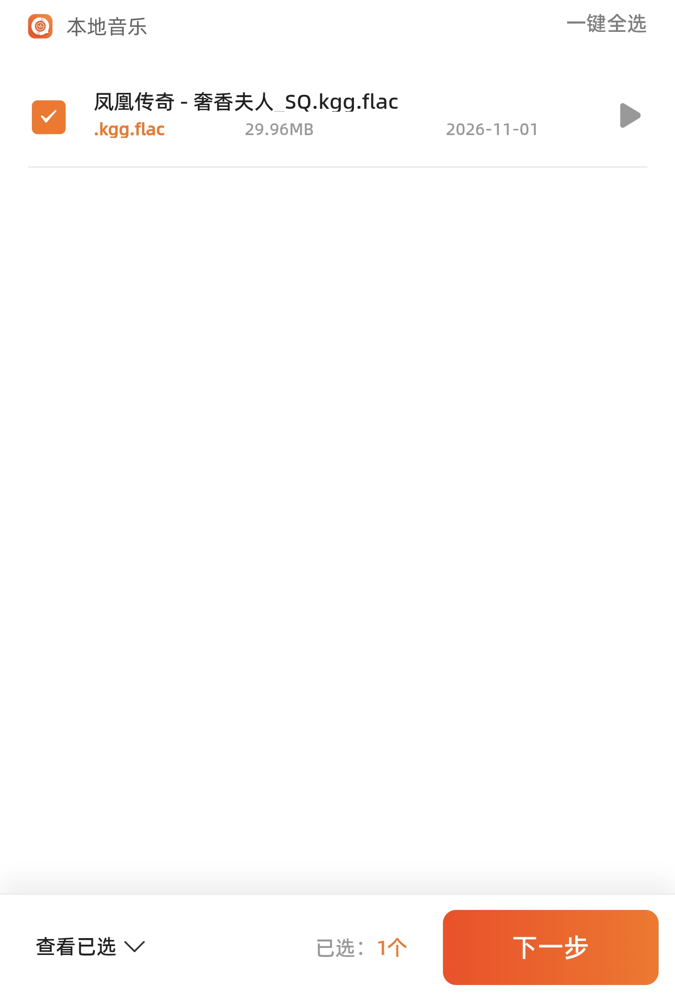

然后选择想要导出的文件类型，想要**无损**音质选择 **flac** 文件，高品或**标准**选择 **mp3** 文件。其他默认不变。

| 设置格式                                                  | 选择完毕                                                  |
| --------------------------------------------------------- | --------------------------------------------------------- |
| 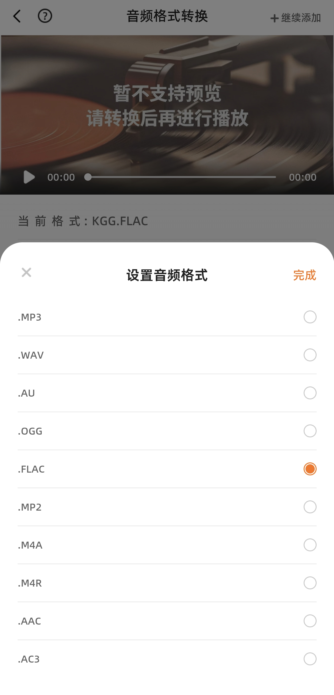 | 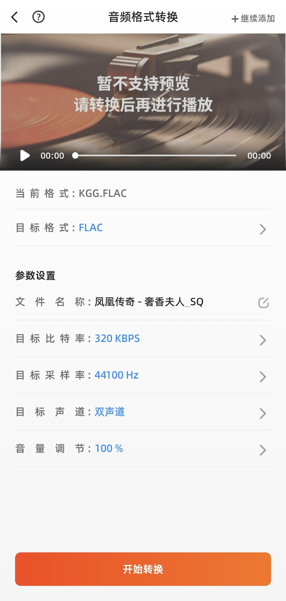 |

成品就是这样的 ↓ 无视付费，看下一步。

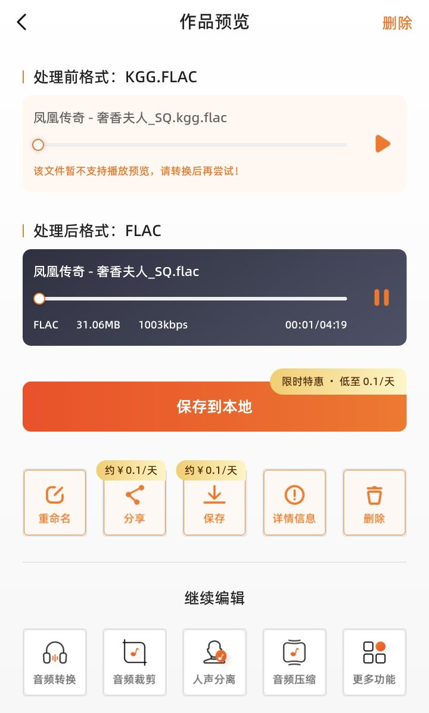

**第五步**：打开 “**MT 管理器**” 或 **电脑连接手机** 进行文件编辑。跟着下面的表格从左到右依次进入文件夹。（每张图片左侧为操作，右侧为进去后的情况）

*其实做完第四步就已经生成了一个完整的音频文件*

MT 管理器 下载链接：https://mt.cc/download/

| 进入 Android                                                | 进入 data                                                   | com.ydease等                                                |
| ----------------------------------------------------------- | ----------------------------------------------------------- | ----------------------------------------------------------- |
| 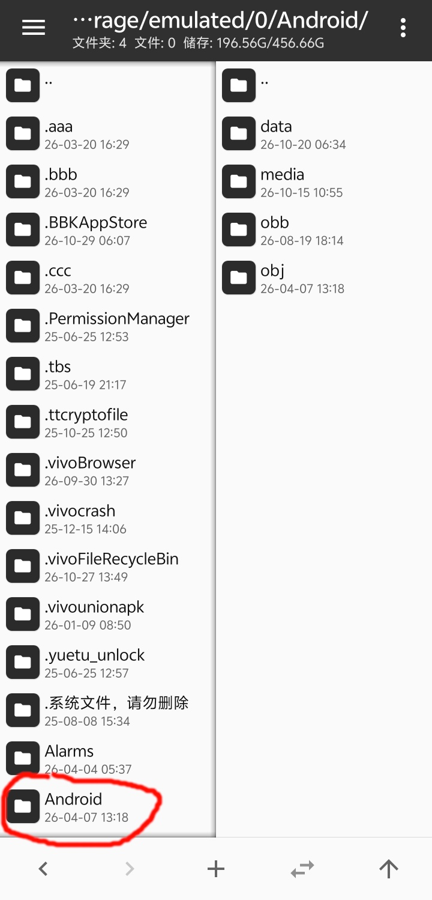 | 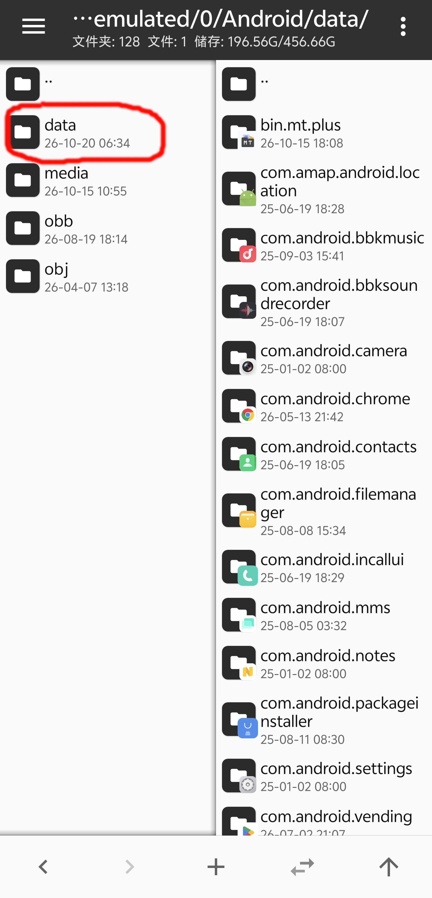 | 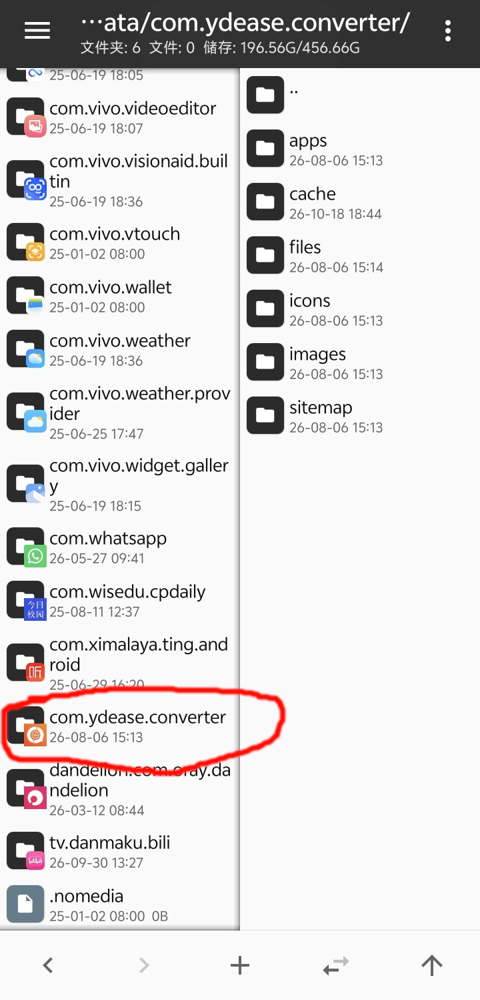 |

| files                                                       | Music                                                       |
| ----------------------------------------------------------- | ----------------------------------------------------------- |
| 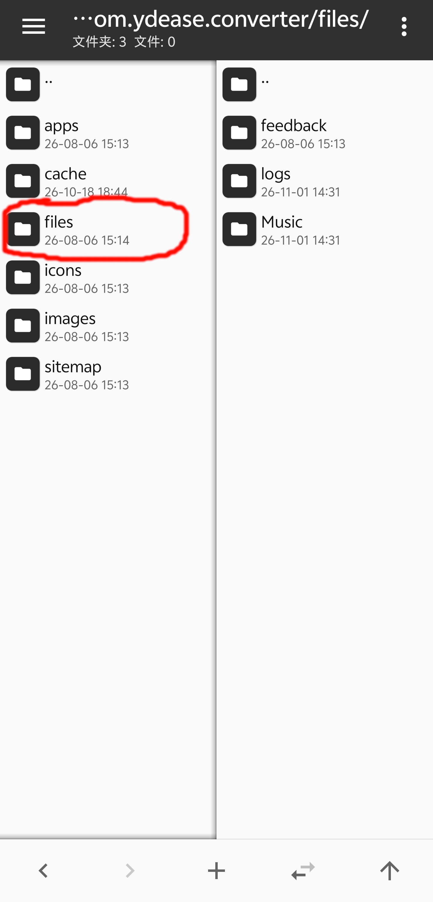 | 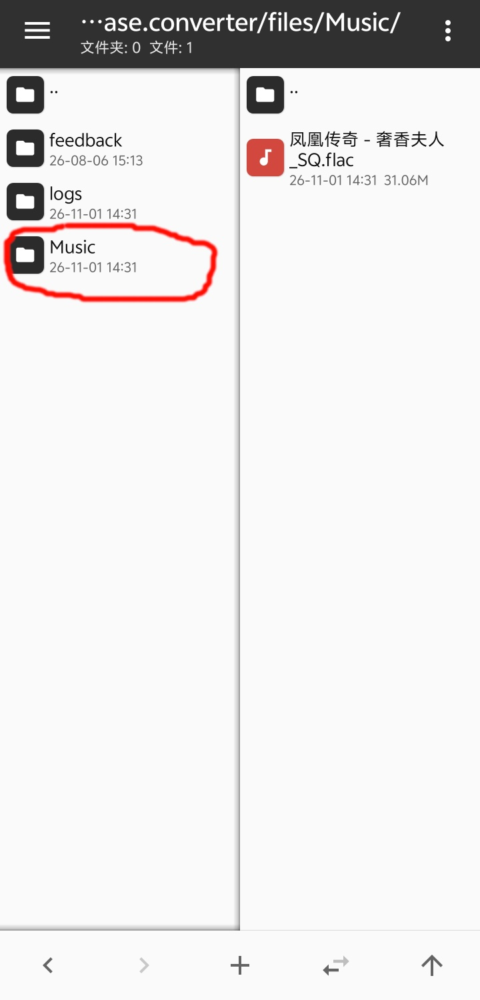 |

最后移动到能记住的地方，这里选择了放到 ` ~/Music` 下。长按 flac 文件，弹出下面的弹窗，然后移动。

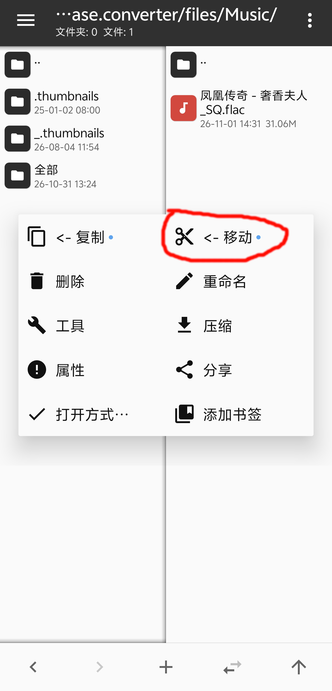

成功。下次听歌或想传给其他设备上就去这个文件夹。

## 思路

**首先**，构建大框：需要：一个可以破解音乐的工具，以及一个可供下载加密音乐的平台。

从 “可供下载加密音乐的平台” 这一点看就只能从 “酷狗概念版” 入手了，因为只有这一个平台是可以提供免费 SVIP 的。

最开始是想在电脑上破解的，因为电脑的工具很容易找到开源的。但是也正是因为这些工具是开源的，酷狗在近几年开发出了一种新的加密方式：需要配合用户的 VIP 密钥。这也就意味着：想要音乐原件，破解工具和 VIP 音乐平台必须在同一个设备上。

要知道，酷狗概念版是没有电脑版的。也就是说，电脑免费获取音乐原件的方法基本就是死路。除非我手写一个与酷狗公私钥结合获取音频的脚本。（*我要是有那能耐我也不可能写这种文章* 🙁）

**然后**，寻找手机破解工具。

我在网上搜索文章，那些文章几乎都是用的电脑，根本没有用手机的完整教程。在手机的应用商店上找了几个工具，大部分都是骗人的，根本不能破解音频。最后只找到两个。一个就是这个 “硬柿子音视频转换器”，另一个忘了叫什么名了，后面这个无论是防护还是客户端页面都做得非常厉害，我没有办法把破解后的音频免费提取出来。

**最后**，有了工具就使用工具。你不是破解完了吗？既然在软件里能播放，那就一定会有我能获取到的渠道。我可不信一个小公司的防护能做得比酷狗还好。这个 “硬柿子” 的防护工作根本没有做，破解后的音乐就躺在 `./files/Music` 这个文件夹下。这名字一看不就知道了嘛。（*给这软件充 VIP 的也是神了* 😂）

## 最后

如果是要用电脑听，个人推荐使用 MusicPlayer2。其他设备就用酷狗，QQ，网易云等平台扫描这些音乐就可以听了（走本地）。

------

仅作技术参考，请勿用于侵权以及商业用途！

如果你在阅读时发现了任何错误，请评论或发邮件告诉我，因为错误是学习和发展的一部分！
